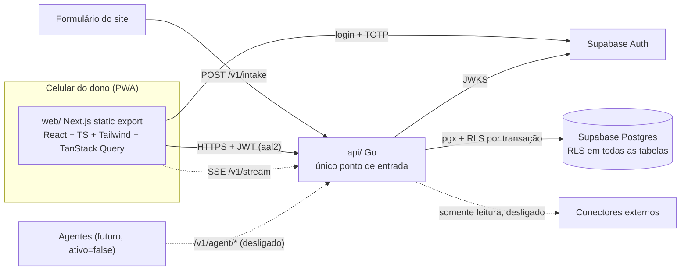
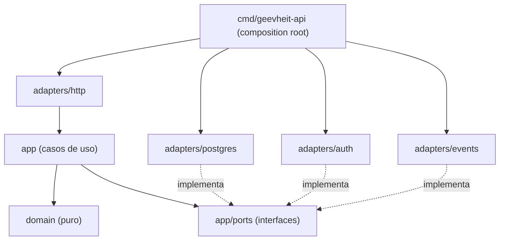

# Arquitetura — GeevheitNeural

> Versão 0.1 — 2026-10-18. Status: **proposta, aguardando aprovação**.
> Complementa: [PRD](./PRD.md) · [System Design](./SYSTEM_DESIGN.md) · [Tasks](./TASKS.md).

## 1. Visão geral



**Regra de ouro:** toda ação (tela, comando de voz, agente futuro, formulário) passa pela **API Go**.
O frontend fala com o Supabase **apenas para autenticação**; nunca lê/escreve tabelas diretamente.

## 2. Monorepo

```
/
├── api/                         # Go — API e orquestrador
│   ├── cmd/geevheit-api/        # main.go = composition root (única peça que conhece tudo)
│   ├── internal/
│   │   ├── domain/              # regras puras, sem I/O, sem dependências externas
│   │   │   ├── card/            # Card, Stage, máquina de estados, portões
│   │   │   ├── money/           # Money (centavos, BRL)
│   │   │   ├── approval/        # Approval, Decision
│   │   │   ├── system/          # SystemState (pausado), ExecutionGuard
│   │   │   ├── agent/ connector/
│   │   │   ├── ledger/ inventory/
│   │   │   └── command/         # parser e resolução de ambiguidade (fase 3)
│   │   ├── app/                 # casos de uso + portas (interfaces)
│   │   ├── adapters/
│   │   │   ├── http/            # handlers, DTOs, middlewares, SSE
│   │   │   ├── postgres/        # sqlc (gerado) + repositórios + UnitOfWork/RLS
│   │   │   ├── auth/            # verificação JWT Supabase (JWKS)
│   │   │   └── events/          # broker em memória
│   │   └── config/
│   ├── openapi.yaml             # contrato (spec-first)
│   ├── sqlc.yaml
│   └── Dockerfile
├── web/                         # Next.js App Router (static export)
│   ├── src/app/                 # rotas: hoje, quadro, apps, financas, conexoes, login
│   ├── src/features/<feature>/  # componentes, hooks e chamadas por feature
│   ├── src/shared/              # ui, api-client, auth, theme, pwa
│   └── public/                  # manifest.webmanifest, sw.js, ícones
├── db/
│   ├── migrations/              # goose, SQL puro, versionadas
│   ├── tests/                   # pgTAP (RLS, imutabilidade)
│   └── seed/                    # dados de desenvolvimento (sem dados reais)
├── docs/                        # PRD, MEMORY, SYSTEM_DESIGN, ARCHITECTURE, TASKS
├── .agents/rules/               # regras para agentes de código
└── .github/workflows/           # CI
```

## 3. Camadas do backend (Clean / Hexagonal)



Regras de dependência (verificadas em revisão e por teste de import):
- `domain` não importa nada do projeto nem bibliotecas de I/O.
- `app` importa `domain` e declara as **portas** (`CardRepository`, `ApprovalRepository`, `UnitOfWork`, `Auditor`, `EventPublisher`, `Clock`, `SystemStateReader`…).
- `adapters/*` implementam portas; nunca são importados por `app` ou `domain`.
- Só `cmd/geevheit-api` instancia e liga as peças (injeção de dependência manual, sem framework).

## 4. SOLID aplicado

| Princípio | Como aparece no GeevheitNeural |
|---|---|
| **S** — Responsabilidade única | Um caso de uso por arquivo (`ApproveGate`, `RejectCard`, `PauseSystem`…). Handler HTTP só traduz HTTP ↔ caso de uso. Repositório só persiste. |
| **O** — Aberto/fechado | Novos comandos de voz = novo `CommandHandler` registrado, sem alterar o parser. Novos conectores = nova implementação de `Connector`. Novas fontes de risco (agente QA) = novo `RiskSource`. |
| **L** — Substituição de Liskov | Qualquer `EventPublisher` (memória hoje, Postgres NOTIFY amanhã) e qualquer `CardRepository` (Postgres, fake de teste) satisfazem o mesmo contrato e os mesmos testes de contrato. |
| **I** — Segregação de interfaces | Portas pequenas: `CardReader` ≠ `CardWriter`; agente recebe só `AgentCardReader` + `ProgressRecorder`, nunca algo que aprove. |
| **D** — Inversão de dependência | `app` depende de interfaces que ele mesmo declara; Postgres, Supabase Auth e SSE são detalhes plugados no `main`. |

**Segurança pelo sistema de tipos:** `ApproveGate` exige um `domain.OwnerPrincipal`, que só o middleware de auth do dono consegue construir. Um `AgentPrincipal` não compila nesse caminho — "agente nunca aprova" é garantido em tempo de compilação, além de RLS e testes.

## 5. Frontend

- **Next.js App Router com `output: 'export'`** (estático) ⇒ hospedagem gratuita no Cloudflare Pages sem servidor Node.
  Consequência: sem Server Actions/SSR; todo dado vem da API via TanStack Query. Rotas de detalhe usam query string (`/quadro?card=…`) ou drawer.
- Organização por feature (`features/hoje`, `features/quadro`, …); `shared/` para UI e infraestrutura.
- Componentes de apresentação sem acesso a dados; hooks (`useCards`, `useApproveGate`) encapsulam TanStack Query (SRP/DIP no front).
- PWA: `manifest.webmanifest` + **service worker escrito à mão** (cache do app shell + network-first para `GET /v1/*`) ⇒ offline para leitura sem dependência extra.
- Tema claro/escuro por CSS variables + `prefers-color-scheme` + alternância manual.
- Visual e textos: **reproduzir o protótipo aprovado** (pendente acesso — ver MEMORY).

## 6. Decisões de arquitetura (ADRs)

| # | Decisão | Alternativas | Motivo |
|---|---|---|---|
| ADR-001 | Router **`net/http` da stdlib** (Go ≥ 1.22 tem padrões com método e path) | chi | Zero dependência; o spec permite ambos. |
| ADR-002 | **sqlc + pgx/v5** | ORM | SQL explícito e revisável, tipos gerados, sem reflexão em runtime. |
| ADR-003 | **goose** com migrations SQL em `/db/migrations` | golang-migrate, Supabase CLI migrations | Arquivo único up/down, roda como lib no CI e como CLI local. |
| ADR-004 | **Supabase Auth com MFA TOTP**; API valida JWT via JWKS e exige `aal=aal2` e `sub = OWNER_USER_ID` | Auth próprio | 2FA pronto e gratuito; dupla checagem na API. |
| ADR-005 | **RLS aplicada também ao tráfego da API**: cada request abre transação com `SET LOCAL ROLE authenticated` + `request.jwt.claims` | API com service role (bypass RLS) | Defesa em profundidade: um bug na API não vaza nem altera dados fora da política. |
| ADR-006 | Formulário público usa role `geev_intake` com **apenas `EXECUTE`** em `intake_create_card()` (`SECURITY DEFINER`) | Inserir com role da API | Privilégio mínimo para o único endpoint anônimo. |
| ADR-007 | `card_events`, `approvals`, `audit_log` **imutáveis** (sem policy de UPDATE/DELETE + trigger que bloqueia) | Só convenção | Imutabilidade garantida pelo banco. |
| ADR-008 | Tempo real por **SSE** da própria API, alimentado por broker em memória atrás da porta `EventPublisher` | Supabase Realtime, WebSocket | Mantém a API como único ponto; SSE é nativo no browser; trocável por `LISTEN/NOTIFY` se houver mais de uma instância. |
| ADR-009 | Dinheiro em **`bigint` centavos** + moeda `BRL` | `numeric`/float | Sem erros de arredondamento; soma barata. |
| ADR-010 | **ExecutionGuard** central: toda execução de agente/conector chama `guard.Allow(actor)`, que nega se `paused` ou `ativo=false`; espelhado em RLS via `geev.can_execute()` | Checagens espalhadas | Um ponto único e testável para o critério de aceite mais crítico. |
| ADR-011 | Barra de comando com **parser determinístico** no backend (sem LLM nesta fase) | LLM | Previsível, testável, sem custo; ambiguidade ⇒ `needs_clarification`. |
| ADR-012 | Contrato **OpenAPI escrito à mão (spec-first)**, validado no CI | Gerar do código | É o contrato para agentes e para o app Flutter da Fase 2. |
| ADR-013 | Isolamento LGPD por `client_id` obrigatório em todo dado de cliente + export/expurgo por cliente | Um projeto Supabase por cliente | Viável no plano gratuito; **a confirmar com o dono**. |

## 7. Dependências

Princípio: **stdlib primeiro**. Toda dependência nova precisa de linha nesta tabela.

### API (Go)
| Dependência | Uso | Justificativa |
|---|---|---|
| `github.com/jackc/pgx/v5` | Driver Postgres | Driver de referência, usado pelo sqlc. |
| `sqlc` (ferramenta, não runtime) | Geração de queries tipadas | Exigido pelo spec; sem custo em runtime. |
| `github.com/pressly/goose/v3` | Migrations | Exigido pelo spec (goose ou migrate). |
| `github.com/golang-jwt/jwt/v5` | Validar JWT do Supabase | Evita implementar criptografia à mão; JWKS com cache próprio (~60 linhas). |
| `golang.org/x/time/rate` | Rate limit do endpoint público | Mantido pelo time do Go; token bucket pronto. |

### Web
| Dependência | Uso | Justificativa |
|---|---|---|
| `next`, `react`, `react-dom`, `typescript` | Base | Exigido pelo spec. |
| `tailwindcss` (v4) | Estilo | Exigido pelo spec. **Versão a confirmar.** |
| `@tanstack/react-query` | Cache/estado de servidor | Exigido pelo spec. |
| `@supabase/supabase-js` | Só login + MFA TOTP | Fluxos de MFA prontos; nenhuma consulta a tabelas pelo front. |
| `vitest`, `@testing-library/react` (dev) | Testes de componentes/hooks | Rápido, compatível com TS sem config pesada. |

### Ferramentas de CI (sem impacto em runtime)
`golangci-lint`, `supabase` CLI (Postgres + Auth locais e pgTAP), `eslint` (via Next).

## 8. Qualidade

- **Testes de domínio** (unidade, sem banco): portões, transições, ExecutionGuard, parser de comandos.
- **Testes de caso de uso** com fakes das portas.
- **Testes de integração** dos repositórios contra Postgres local (Supabase CLI).
- **pgTAP** para RLS e imutabilidade.
- **CI** (GitHub Actions): `gofmt`, `go vet`, `golangci-lint`, `sqlc diff`, `go test -race`, pgTAP, `eslint`, `tsc --noEmit`, `vitest`, `next build`.
