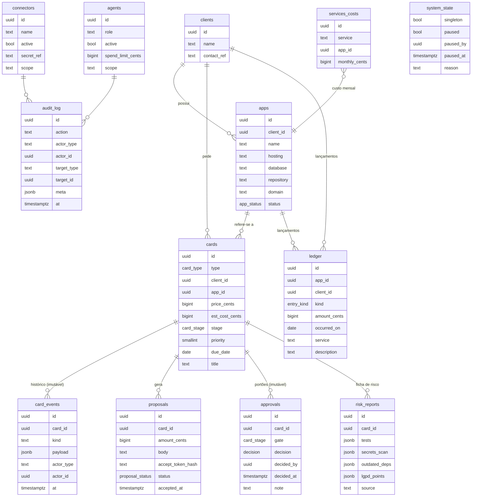
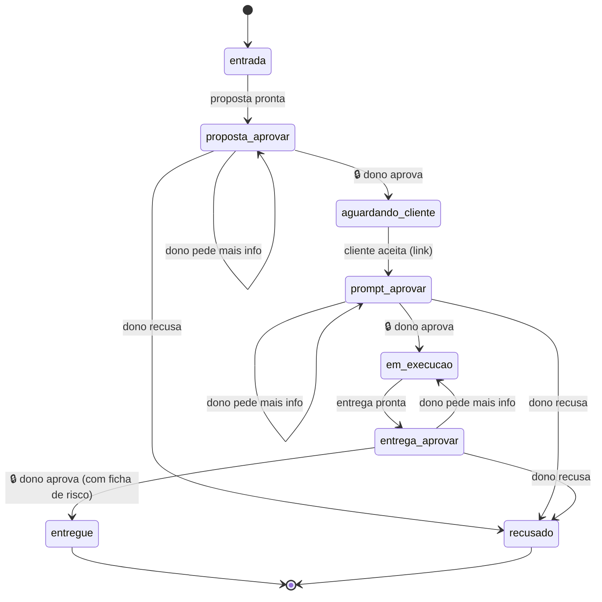
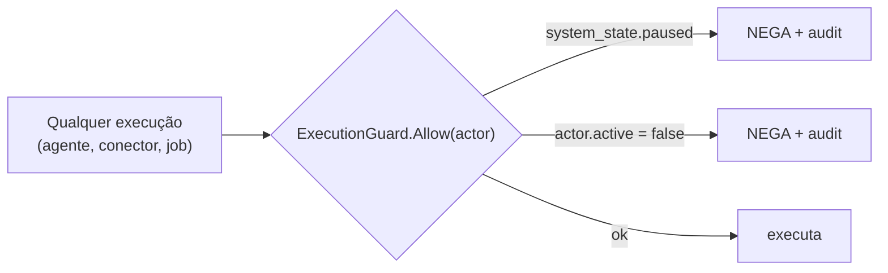
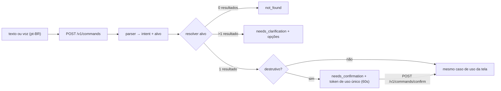

# System Design — GeevheitNeural

> Versão 0.1 — 2026-10-18. Status: **proposta, aguardando aprovação**.

## 1. Modelo de dados

Schema `geev`. Toda tabela tem `id uuid`, `owner_id uuid` (default `auth.uid()`), `created_at` e, quando mutável, `updated_at`.
Dinheiro em `bigint` (centavos). Todas com **RLS habilitada e forçada** (`ENABLE` + `FORCE ROW LEVEL SECURITY`).



**Tabelas além do mínimo do spec** (justificadas):
- `risk_reports` — RF-08 precisa de estrutura própria para receber dados manuais e, no futuro, dos agentes de QA/segurança.
- `system_state` — linha única com o estado do Botão Parar (RF-09).

**Enums**
- `card_type`: `orcamento | bug | suporte | financeiro`
- `card_stage`: `entrada | proposta_aprovar | aguardando_cliente | prompt_aprovar | em_execucao | entrega_aprovar | entregue | recusado`
- `decision`: `aprovado | mais_info | recusado`
- `entry_kind`: `receita | custo`

**Imutabilidade:** `card_events`, `approvals` e `audit_log` só têm policy de `INSERT`/`SELECT`, e um trigger `BEFORE UPDATE OR DELETE` gera exceção.
**Segredos:** `connectors.secret_ref` guarda só o **nome** da variável/cofre (ex.: `GEEV_SECRET_GITHUB`); o valor nunca chega ao banco nem ao frontend.

## 2. Máquina de estados do cartão



🔒 = portão do dono. Sair de um portão **só** via caso de uso `DecideGate(OwnerPrincipal, cardID, decision, note)`, que em **uma transação**:
1. valida a transição no domínio (`card.Decide`);
2. insere `approvals` (imutável);
3. atualiza `cards.stage`;
4. insere `card_events` e `audit_log`;
5. após commit, publica `MoneyWaitingChanged`.

> "Pedir mais informações" na entrega volta para *Em execução*; nos outros portões mantém o estágio e registra o pedido. **A confirmar** (ver MEMORY).

## 3. Autenticação e RLS

```mermaid
sequenceDiagram
  participant W as PWA
  participant SA as Supabase Auth
  participant A as API Go
  participant DB as Postgres
  W->>SA: email+senha
  SA-->>W: sessão aal1
  W->>SA: código TOTP
  SA-->>W: JWT aal2
  W->>A: GET /v1/today (Bearer JWT)
  A->>A: valida assinatura (JWKS), exp, aal2, sub == OWNER_USER_ID
  A->>DB: BEGIN; SET LOCAL ROLE authenticated; set_config('request.jwt.claims', ...)
  A->>DB: queries (RLS: owner_id = auth.uid() AND aal2)
  A->>DB: COMMIT
  A-->>W: 200 JSON
```

- Cadastro público **desligado** no Supabase; o usuário dono é criado uma vez pelo CLI/dashboard.
- Policies usam função `geev.is_owner()` = `auth.uid() = owner_id AND auth.jwt()->>'aal' = 'aal2'`.
- A API conecta com role `geev_api` (sem `BYPASSRLS`), que só pode assumir `authenticated` e `geev_intake`.

## 4. Botão Parar e ExecutionGuard



- `PauseSystem(owner, reason)` / `ResumeSystem(owner)` — só o dono; ambos em `audit_log`.
- Ao pausar: `system_state.paused = true`; todos os `agents.active` e `connectors.active` ficam **efetivamente** bloqueados (o guard checa os dois). Os flags individuais não são alterados, para que a retomada não ligue nada que estava desligado.
- Espelho no banco: `geev.can_execute(actor_id)` usado em policies de escrita de agentes (defesa em profundidade).
- Frontend: faixa fixa "Sistema pausado" em todas as telas enquanto `paused`.

## 5. Dinheiro parado (tempo real)

- Valor = `SUM(price_cents)` e `COUNT(*)` de cartões em `proposta_aprovar | prompt_aprovar | entrega_aprovar`.
- `GET /v1/money-waiting` para o valor inicial; `GET /v1/stream` (SSE) envia `money_waiting` a cada mudança.
- Casos de uso que mudam estágio publicam evento pelo `EventPublisher` **após o commit**.

## 6. Hoje — 3 decisões do dia

Cartões em portões, ordenados por `price_cents DESC`, depois prazo mais próximo; limite 3.
Recomendação de 1 linha gerada por regras do domínio (sem IA), ex.:
- margem ≥ 40% ⇒ "Aprovar — margem de 62%";
- custo estimado > valor ⇒ "Rever preço — custo maior que o valor";
- entrega com ficha de risco com falha ⇒ "Pedir correção — 2 segredos expostos".

## 7. Barra de comando (fase 3)



Respostas: `executed | needs_clarification | needs_confirmation | not_found | rejected_by_gate`.
Normalização: minúsculas, sem acentos, tokens; casamento por nome de cliente/app/título do cartão.

## 8. Entrada de pedidos (fase 4)

`POST /v1/intake` (público): validação de esquema, honeypot, tempo mínimo de preenchimento, rate limit por IP (token bucket), tamanho máximo do corpo; chama `intake_create_card()` via role `geev_intake` ⇒ cartão em **Entrada**. IP não é persistido (LGPD), só um hash diário para limitar abuso.

## 9. Contratos dos agentes (fase 5, desligados)

| Endpoint | Ação |
|---|---|
| `GET /v1/agent/cards` | listar cartões do estágio do agente |
| `GET /v1/agent/cards/{id}` | ler contexto |
| `POST /v1/agent/cards/{id}/progress` | registrar progresso |
| `POST /v1/agent/cards/{id}/attachments` | anexar resultado |
| `POST /v1/agent/cards/{id}/approval-requests` | **solicitar** aprovação (nunca aprovar) |

Auth por token do agente (hash no banco). Todos passam pelo `ExecutionGuard` ⇒ hoje respondem `423 Locked` (agente inativo).

## 10. Hospedagem gratuita e limites

> Limites conferidos em memória de projeto; **revalidar na hora do deploy**, pois planos mudam.

| Camada | Serviço | Limites relevantes (free) | Gatilho para migrar | Plano de migração |
|---|---|---|---|---|
| Front | Cloudflare Pages | Banda ilimitada, ~500 builds/mês | — | Improvável precisar. |
| API | Render (free web service, Docker) | Hiberna após ~15 min sem tráfego (cold start ~30–60 s), 750 h/mês | Cold start atrapalhar o uso diário | Render Starter, Fly.io ou VPS pequena; a imagem Docker é a mesma. |
| Banco/Auth | Supabase Free | 500 MB de banco, pausa após 7 dias sem atividade, 2 projetos | > 400 MB ou pausas | Supabase Pro; ou Postgres gerenciado + migrations goose (portáveis). |

Notas operacionais:
- No Render, conectar pelo **pooler do Supabase em modo transação (porta 6543)** e usar `QueryExecModeSimpleProtocol`/sem cache de prepared statements no pgx.
- Um ping diário (GitHub Actions cron) evita a pausa do Supabase por inatividade.

## 11. Observabilidade e LGPD

- Logs estruturados (`log/slog`, JSON) com `request_id`; **sem** nomes, e-mails, telefones ou corpo de pedidos.
- `audit_log` guarda IDs e ação; detalhes pessoais ficam só nas tabelas de domínio, sob RLS.
- Por cliente: export (JSON) e expurgo (anonimiza `clients` e conteúdo de `cards`, mantém valores no `ledger`).
